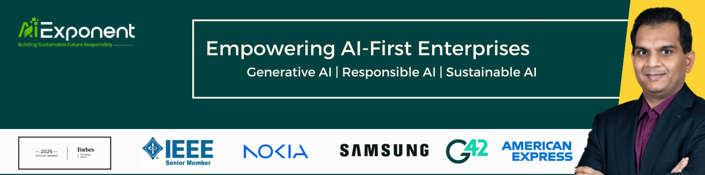

# Ajay Pundhir

**Global AI Strategist | Head of AI at Presight (G42) | Founder, AiExponent**

Global AI strategist and enterprise leader at the forefront of the autonomous era. I orchestrate the delivery of large-scale, industrial-grade AI platforms at Presight (G42), transforming breakthrough research into sovereign-scale solutions — with a dual commitment to technical precision and institutional integrity, particularly in the operationalization of Responsible and Agentic AI.

As Founder of AiExponent, I translate nearly two decades of leadership into high-stakes strategic counsel — Board and Executive Advisory on AI governance, confidential Leadership Coaching for C-suite executives, and founder mentorship through Stanford SEED and LISA programs.

**Credentials:** IEEE Senior Member · HBS Advisory Council · MIT Technology Review Committee · Forbes Technology Council · Senior Executive AI Think Tank · Stanford SEED & LISA Mentor · IAPP AIGP Certified

🔭 **Currently exploring:** Agentic AI guardrails & safety · AI risk classification across regulatory contexts · 'Cognitive capital' as a measurable organizational asset

---

## 🔬 Open Source & Frameworks

| Project | What It Solves |
|---------|---------------|
| [rag-benchmarking](https://github.com/apundhir/rag-benchmarking) | Standardized evaluation of RAG pipelines — relevance, faithfulness, latency |
| [advanced-rag-knowledge-engine](https://github.com/apundhir/advanced_rag_knowledge_engine) | Production RAG with knowledge routing, guardrails & observability |
| [license-compliance-checker](https://github.com/apundhir/license-compliance-checker) | AI-era license scanning — RAIL, Llama, dataset licenses, SPDX |
| [agentic-document-analyser](https://github.com/apundhir/agentic_document_analyser) | High-throughput document intelligence — Qwen2-VL + FastAPI |
| [ai-roi-calculator](https://github.com/apundhir/ai-roi-calculator) | Quantify AI initiative business impact for CXO decision-making |
| [ai-skill-planner](https://github.com/apundhir/ai_skill_planner) | Map AI capabilities, identify gaps, generate upskilling roadmaps |

---

## 📊 Impact

| 70% | Multi-million $ | Full-lifecycle |
|:---:|:---:|:---:|
| Reduction in enterprise model time-to-deployment | Annualized value through AI-driven optimization | Responsible AI governance operationalized |

---

## ✏️ Latest Writing

<!-- BLOG_POSTS_START -->
- [The Hidden Tax on AI Speed](https://aiexponent.com/the-hidden-tax-on-ai-speed/)
- [AiExponent: 2 Minutes on What’s Next in AI](https://aiexponent.com/aiexponent-2-minutes-on-whats-next-in-ai/)
- [The Real Cost of AI Isn’t Ethics, “It’s Rework”](https://aiexponent.com/the-real-cost-of-ai-isnt-ethics-its-rework/)
- [Stop Waiting for the Perfect AI Governance Framework. Start With “MVG”](https://aiexponent.com/ai-governance-framework-minimum-viable-governance/)
- [Open Source AI: The Ultimate Risk & Reward Guide](https://aiexponent.com/open-source-ai-the-ultimate-risk-reward-guide/)

<!-- BLOG_POSTS_END -->

### Featured Publications

- **AI 2026: Major Industry and Cultural Shifts (and How to Prepare)** — *Senior Executive AI Think Tank* (Jan 2026) [Read →](https://seniorexecutive.com/ai-reshaping-culture-work-2026/)
  > "We'll see 'cognitive capital' emerge as a measurable asset, where uniquely human capabilities like ethical reasoning, creative synthesis and stakeholder empathy become premium competencies no algorithm can replicate."
- **Why Smaller, Task-Specific Language Models Are the Smarter Choice** — *Datacentre Dynamics*

---

## 🤝 Advisory & Speaking

AiExponent is an elite strategic advisory firm dedicated to catalyzing the transition from generative experimentation to agentic AI reality.

**For Organizations & Leaders:** Board & Executive Advisory · Leadership Coaching · Speaking Engagements

**For Individuals & Founders:** AI Startup Mentorship · AI Mentoring for Professionals · AI Mentoring for Students (pro bono)

**Topics:** Enterprise AI Strategy & Sovereign-Scale Platforms · Responsible & Agentic AI — Operationalization · AI Governance, Risk Classification & Policy · From Generative Experimentation to Agentic Reality · Cognitive Capital — Valuing Human Judgment in the AI Era

### Upcoming

- **Me2We 2026 — Stanford Graduate School of Business** (March 2026) — *Leading Through Obsolescence*

---

## 🤝 Connect

Translating AI ambition into tangible reality. Available for board advisory, AI strategy reviews, keynote speaking, executive coaching, and due diligence.

    

---

> "We don't merely decode the language of numbers. We transform data into wisdom, and curiosity into discovery. Data is the compass that guides us, but it is our human curiosity that sails the ship. Lead with questions, follow with insights."

🔄 Profile auto-updated on April 04, 2026 at 11:14 AM GST · Powered by [GitHub Actions](https://github.com/apundhir/apundhir/actions)

